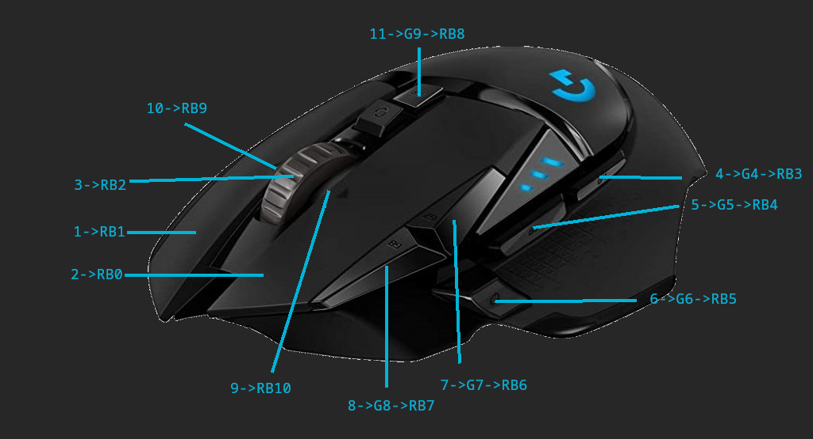

# Logitech G502 button map

The annotated diagram shows each button with its manual number, G-name, and
the **ratbag index** used by `g502-apply-profile.py` and `g502-profiles.json`
in this directory. The unannotated photo is at `g502-photo.png`.

> Note: ratbag numbers the buttons differently from the manual. The tilt wheel
> and profile button are the main differences — check the table, not the
> manual's numbering, when editing profiles.

<table>
  <tr>
    <td valign="top">
      
    </td>
    <td valign="top">

| Manual # | Button | G-name | ratbag index | Notes |
| --- | --- | --- | --- | --- |
| 1 | Left click | — | `0` | |
| 2 | Right click | — | `1` | |
| 3 | Wheel click | — | `2` | |
| 4 | Back | G4 | `3` | rear thumb button |
| 5 | Forward | G5 | `4` | forward thumb button |
| 6 | DPI Shift (sniper) | G6 | `5` | thumb rest; hold for temporary DPI |
| 7 | DPI Down | G7 | `6` | below wheel |
| 8 | DPI Up | G8 | `7` | below G7 |
| 9 | Scroll left | — | `10` | wheel tilt left |
| 10 | Scroll right | — | `9` | wheel tilt right |
| 11 | Profile select | G9 | `8` | behind wheel |
| 12 | Wheel mode shift | — | n/a | not programmable |

    </td>
  </tr>
</table>

## Usage

```bash
./g502-apply-profile.py --list     # list profiles in g502-profiles.json
./g502-apply-profile.py wot        # apply the "wot" profile
./g502-apply-profile.py desktop    # apply the "desktop" profile
```

Profiles are defined in `g502-profiles.json`; each entry names a ratbag
profile slot plus resolutions, buttons (by ratbag index), and LEDs.

## D-Bus profile-switching proof of concept

This separate experiment talks directly to ratbagd over the system D-Bus,
without running `ratbagctl`. It requires ratbagd and Python's PyGObject
bindings (usually the `python3-gi` package).

For the packaged Python application, see [ratbag-profile](ratbag-profile/).

```bash
python3 g502-dbus-poc.py      # list hardware profile slots and active slot
python3 g502-dbus-poc.py 1    # switch to slot 1
python3 g502-dbus-poc.py 0    # switch back to slot 0
```

The script switches existing hardware profiles; it does not edit their
settings or replace the launcher. ratbagd commits changes asynchronously, so
the confirmation means the commit was queued, not that the hardware write was
verified.
